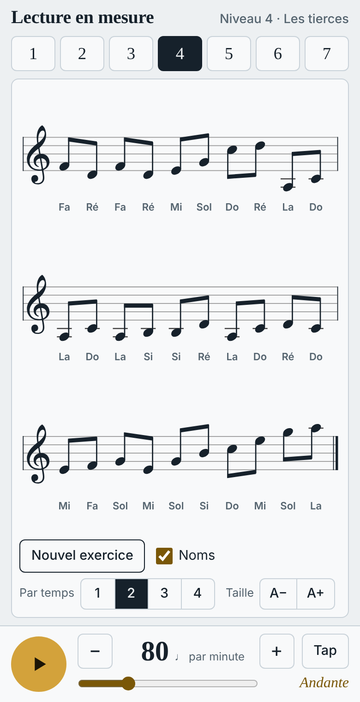

# Lecture en mesure

Petite application web pour apprendre à lire les notes en clé de sol, avec un métronome intégré. Elle fonctionne sur téléphone comme sur ordinateur.

La progression des 7 niveaux s'inspire du *Manuel pratique* de Georges Dandelot (Max Eschig, 1928) : on part de quatre points de repère (Do, Sol, Do, Sol), puis on ajoute les notes voisines, les tierces, les lignes supplémentaires et les octaves. Les exercices sont générés au hasard, ce ne sont pas ceux du livre.

- Notation affichée avec [VexFlow](https://www.vexflow.com/)
- Métronome en Web Audio, de 30 à 220 par minute
- Une seule page, sans étape de compilation : `index.html`

## Utilisation

Ouvrir `index.html` dans un navigateur, ou publier le dépôt avec GitHub Pages.
